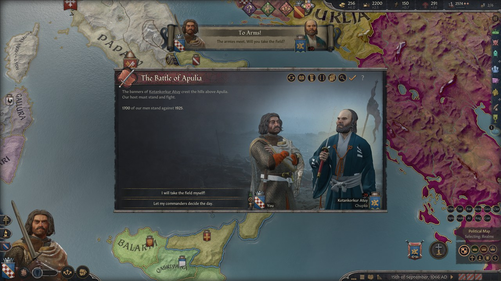
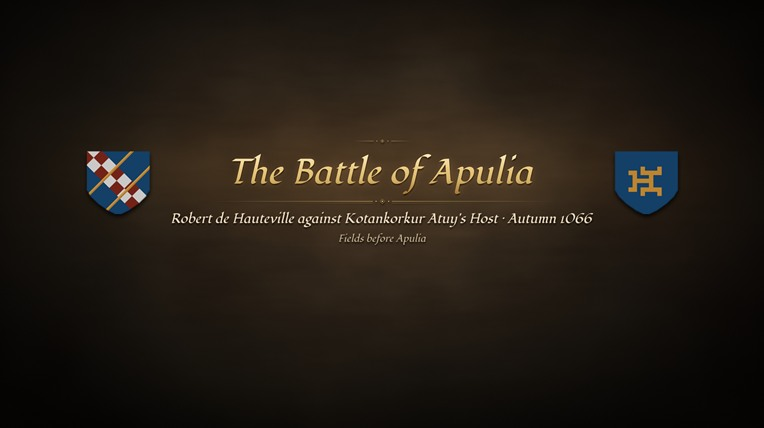
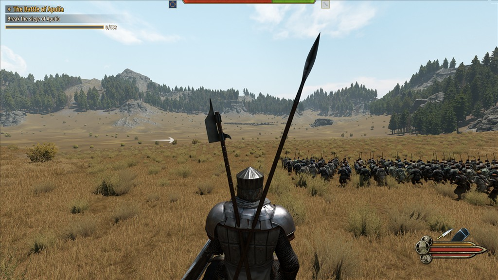
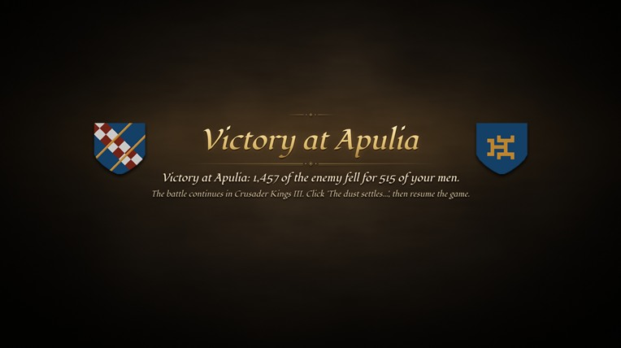
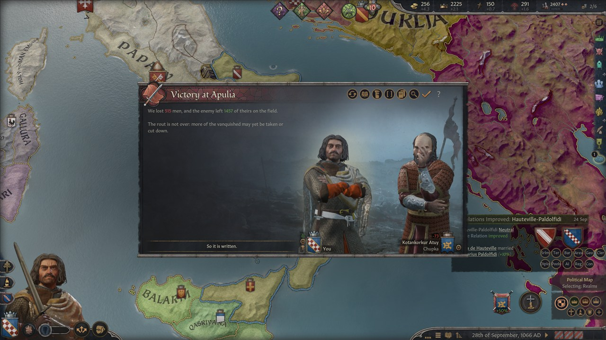

# Crowns & Blades

**Lead your Crusader Kings III armies in person.** When a battle, duel, tournament bout, siege assault or sea battle you take
part in starts in CK3, you can fight it yourself in Mount & Blade II: Bannerlord, as your own character, with your knights at
your side. Then the result goes back into your campaign: losses, wounds, deaths, captives, prestige, war score and lifelong
feats.



> **Status: 0.9.0 (beta).** Every feature below has been played in the real games: one long campaign and many shorter test
> campaigns in Dev mode. It is still a beta, so read [Status](#status) before you start a campaign you care about.

## What it does

Crowns & Blades is three pieces that work together:

- a **CK3 mod**, "Crowns & Blades Battles", that reports your battles and applies their results;
- a small **tray app**, `CK3xBL.exe` (the bridge), that runs both games and carries everything between them;
- a **Bannerlord module**, "CK3 Bridge", that builds the battle in Bannerlord and reports how it went.

A battle goes like this:

1. Armies meet in CK3 and you are involved. CK3 pauses and asks: **"I will take the field myself!"** or **"Let my
   commanders decide the day."**
2. You take the field. CK3 freezes, a title card ("The Battle of Apulia") fades in, and Bannerlord, already loaded in the
   background, appears behind it.
3. You deploy and fight as your CK3 character. Your real armies are on the field: levies and men-at-arms matched to
   Bannerlord troops of the closest culture, your commanders and knights as named heroes in the gear they carry in CK3, your
   coat of arms on the banners, on a field that matches the province's terrain and season.
4. When the battle is over, a result card shows the outcome and you are back in CK3, at the moment you left.
5. CK3 fights the battle out over the next days of game time with the losses from Bannerlord, so war score, the battle
   summary and the aftermath are CK3's own. If fresh troops reach the losing side, you may get a second clash.

See [docs/PLAYING.md](docs/PLAYING.md) for the details.

## What you can fight

| Kind | How it starts in CK3 | In Bannerlord |
|---|---|---|
| **Field battles** | your armies meet an enemy army | your levies, men-at-arms and knights, up to 1000 soldiers |
| **Duels** | challenges, trials by combat, court duels, duels inside battles | one on one; nobles fight in an arena before an audience |
| **Tournaments** | melee, joust and archery bouts of a CK3 tournament | the matching arena bout |
| **Siege assaults** | the decision "Storm the Walls" | a siege with engines from your CK3 regiments, a professional garrison by fort level, wall bonuses and waves of attackers |
| **Relief of a siege** | a relief army reaches a besieged holding | defend the walls, strike the besiegers' camp, or fight before the walls |
| **Sea battles and landings** | the sea decision and sighting events (War Sails DLC) | ships of your culture; a landing fought from the ships onto a beach |
| **Skirmishes** | danger events during travel | a small fight in a forest or a bandit hideout |

## Also adds

- **Battle gear:** ten slots on a Battle Gear page of the CK3 inventory (main weapon, three universal weapon slots, helmet,
  body armour, gloves, boots, cloak, horse). What you equip in CK3 you carry in Bannerlord.
- **The armory:** the decision "Visit the Armory" sells weapons, armour and horses; AI rulers buy gear for their knights.
- **Lifelong feats:** 22 battle, duel, sea and tournament feats with three ranks each, earned by what you do in Bannerlord.
- **Strength balance:** prowess, martial, health and age shape your heroes; a lopsided CK3 battle stays lopsided in Bannerlord.
- **Russian and English** text, following the language CK3 runs in.

## Screenshots

| | |
|---|---|
|  |  |
| The title card, drawn in CK3's style with both coats of arms | The same battle in Bannerlord |
|  |  |
| The result card on the way back to CK3 | CK3 fights it out and records the victory, with native war score |

## Status

Tested on CK3 1.20.1.2 and Bannerlord v1.4.8 (Steam, Windows 11): one long campaign and many shorter test campaigns in Dev
mode, on top of the automated tests and bench runs.

| Feature | Status |
|---|---|
| Field battles, the seamless switch, your real armies, results back to CK3, the battle clock | Played in game |
| Duels in the arena, heroes' prowess and gear | Played in game |
| Siege assaults with garrison, wall bonuses and waves; relief of a siege | Played in game |
| Sea battles and landings (War Sails) | Played in game |
| Tournaments, skirmishes on the road, bandit hideouts | Played in game |
| Feat ranks, battle gear, the armory, AI gear purchases | Played in game |
| War elephants (with Burning Empires), extra costumes (with Open Source Armory, Terra Armarium) | Played in game |
| Install, launch and a battle through Melty, with and without the optional Bannerlord mods | Played, and passed Melty's release test |

It is still a beta: the newest fixes (the result delivery's battle-window check, the Melty install) have fewer hours behind
them than the rest, and balance may still change.

If something goes wrong, see [docs/TROUBLESHOOTING.md](docs/TROUBLESHOOTING.md).

## Requirements

- **Crusader Kings III 1.20.x.** No DLC is required; content from DLCs you own (for example accolades from Tours &
  Tournaments) is used when it is there.
- **Mount & Blade II: Bannerlord v1.4.8.** Other 1.4.x patches are untested.
- **Windows 10 or 11, 64-bit**, with a PC that can keep both games open at the same time.
- **Steam** versions of both games are what this was built and tested with. GOG and Epic installs are detected but untested.
  The Xbox app / Game Pass versions are not supported.
- You need your own copies of both games. No game files are included.

### Optional Bannerlord content

Everything works without these. Put any of them into Bannerlord's `Modules` folder and the bridge uses it on the next battle;
there is no need to enable it in the Bannerlord launcher.

| Add-on | What it adds | Without it |
|---|---|---|
| War Sails DLC | sea battles and landings | a sea clash is fought as a battle on the shore |
| Burning Empires (its `BurningEmpires_Elephants` module) | war elephants for elephant men-at-arms | elephants fight as regular cavalry |
| Open Source Armory, Open Source Saddlery | many more armours, weapons and horse harness | stock Bannerlord equipment |
| Terra Armarium (Universal Core, Byzantine, Rus & Mongols, Late Medieval) | era- and culture-specific armour | stock Bannerlord equipment |

## Install

**With Melty (one click):** install Crowns & Blades in Melty and press **Play**. Melty puts the CK3 mod, the Bannerlord module
and the bridge in place; Play starts the bridge, which enables the mod and starts CK3. If you start CK3 from the Paradox
Launcher instead, add **"Crowns & Blades Battles"** to your playset.

**With the installer:** run `CK3xBL-Setup-0.9.0-beta.exe`. It installs for your Windows user only, needs no administrator
rights, finds both games and installs the bridge, the CK3 mod and the Bannerlord module. The exe is not code-signed, so
Windows SmartScreen may warn you: click **More info**, then **Run anyway**. Then add **"Crowns & Blades Battles"** to your
Paradox Launcher playset. A manual zip and every detail are in [docs/INSTALL.md](docs/INSTALL.md).

## Quick start

1. Start **Crowns & Blades** (Melty's Play, or the Start menu). Its icon appears in the notification area, and Bannerlord
   loads hidden in the background so the first battle starts quickly.
2. Play CK3. When your armies meet, choose **"I will take the field myself!"** and fight.
3. After the battle, click **"The dust settles..."** in CK3 and resume the game. CK3 fights the battle out over the next days.

**Ctrl+Alt+Shift+End** aborts a battle at any point and hands it back to CK3.

For the best result run CK3 in **Fullscreen** (its video options).

## Achievements

The normal mode was designed around CK3's achievement rules: CK3 starts in release mode, the console is never opened, and
results go into CK3 through the mod's own hidden buttons on CK3's modder hotkeys (Ctrl+Shift+Alt with digits and F-keys).
**Dev mode** (tray menu, Launch, Dev mode) uses the console, so achievements are off for a game played that way.

## Known limitations

- **Single player only.** CK3 multiplayer is not supported.
- **One Bannerlord battle at a time.** Other battles wait in line or are resolved by CK3 as usual. Battles you are not part of
  are always CK3's.
- **Battle size is capped at 1000.** Bigger battles froze Bannerlord's engine in testing.
- **Your faces and banners are close, not exact.** Faces are rebuilt from CK3 genes for you and your heir; others get a
  matching stand-in. Charges are the nearest Bannerlord icon of the right kind.
- **CK3's own post-battle rolls still happen.** After the battle, CK3 may still capture or kill some of the defeated side's
  commanders and knights, on top of what happened in Bannerlord.
- **Result delivery types keys.** For a few seconds after a battle, the bridge types the result into CK3's battle window. It
  first checks that the window answers, waits for a quiet moment and briefly holds back your clicks while it types.
- **Other mods:** tested with a playset of 13 CK3 mods without conflicts, but not with mods that change armies, cultures or
  combat deeply. Unknown men-at-arms types or cultures get fallback troops.

## Documentation

| | |
|---|---|
| [docs/INSTALL.md](docs/INSTALL.md) | Installer walkthrough, manual install, the CK3 playset, uninstall and upgrade |
| [docs/PLAYING.md](docs/PLAYING.md) | A battle step by step, the battle clock, knights, the abort hotkey, every setting |
| [docs/TROUBLESHOOTING.md](docs/TROUBLESHOOTING.md) | Logs and common problems |
| [docs/HOW_IT_WORKS.md](docs/HOW_IT_WORKS.md) | The architecture, for the curious |
| [docs/PROTOCOL.md](docs/PROTOCOL.md) | The exact contract between the three components |
| [docs/BUILDING.md](docs/BUILDING.md) | Building, testing and releasing from source |
| [CHANGELOG.md](CHANGELOG.md) | Everything added since the original bridge |
| [SECURITY.md](SECURITY.md) | Exactly what the bridge does on your PC |

## FAQ

**Do I have to fight every battle?** No. Every time, you can choose "Let my commanders decide the day" and CK3 resolves it
as usual.

**Can I die?** Your character can fall in Bannerlord. By default that becomes a wound or a maiming in CK3, never death or
capture. Set `battle.playerDeathIsReal` to `true` for the hard way. Knights and commanders use CK3's own odds.

**Does it change my game files?** No. The mod goes into your CK3 `mod` folder in Documents and the module into Bannerlord's
`Modules` folder.

**Does it go online?** No. The bridge has no network code and sends no telemetry.

## Building from source

You need Windows, the .NET 10 SDK, Node.js 20 or newer, and both games installed (the Bannerlord module compiles against
the game's own assemblies). Then:

```powershell
dotnet build bridge/CK3xBL.slnx -c Release
dotnet run --project bridge/CK3xBL.SelfTest -c Release
node tools/release/build_release.mjs        # the full release: tests, installer, manual zip, checksums
```

The full guide is [docs/BUILDING.md](docs/BUILDING.md).

## License, disclaimer and credits

- **License:** [MIT](LICENSE), Copyright (c) 2026 TaLyAn. Based on [ck3-bannerlord-bridge](https://github.com/graff0n/ck3-bannerlord-bridge) by graff0n (MIT).
- **Disclaimer:** Crowns & Blades is a free fan project. It is not affiliated with, endorsed by or sponsored by Paradox
  Interactive or TaleWorlds Entertainment. Crusader Kings III is a trademark of Paradox Interactive AB. Mount & Blade II:
  Bannerlord is a trademark of TaleWorlds Entertainment. You need legally owned copies of both games. No game files are
  included: game fonts, textures and data are read from your own installs at run time.
- **Credits:** graff0n for the original bridge; Paradox Interactive and TaleWorlds Entertainment for two games worth
  bridging and open to mods; the authors of Open Source Armory, Terra Armarium and Burning Empires, whose mods the bridge
  can use when you have them. The bridge exe includes the .NET runtime (see `THIRD-PARTY-NOTICES.txt` in the release).

### How this was made (AI disclosure)

This project was built with Anthropic's Claude, through Claude Code, as the engineering agent: it wrote most of the code,
the tests and these documents, and ran bench tests by driving both games. The original bridge was directed by graff0n;
Crowns & Blades is directed by TaLyAn, who sets the goals, makes the design calls, plays the test campaigns and decides what
ships.
