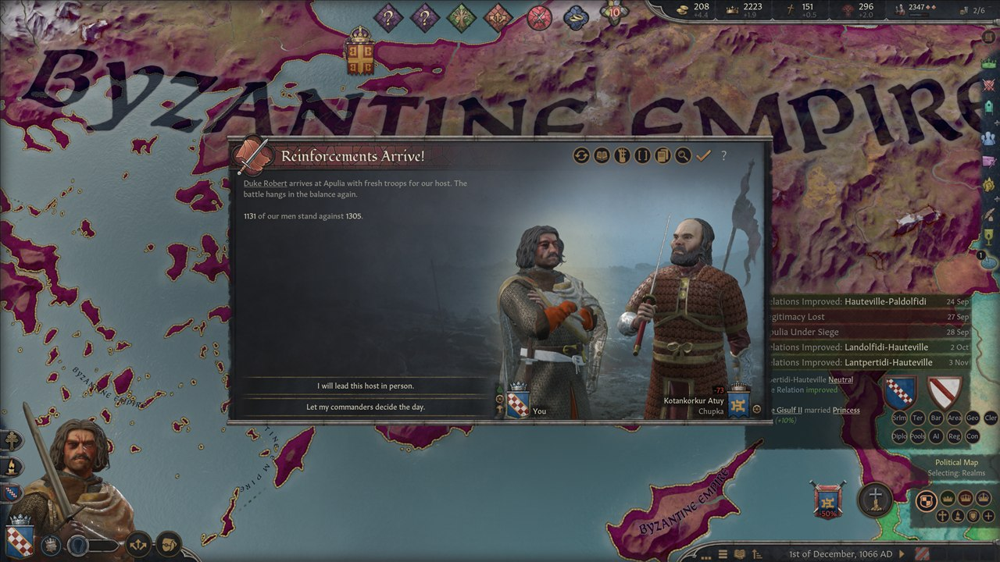

# Crowns & Blades

**Lead your Crusader Kings III armies in person.** When a battle you are part of starts in CK3, you can fight it yourself in
Mount & Blade II: Bannerlord, as your own character, with your knights at your side. Then the result goes back into your
campaign: losses, wounds, deaths, captives, prestige and war score.


> **Status: 0.9.0-beta.** The full loop works and has been played end to end in the real games. Several in-game checks are
> still open, and the installer is new in this release. Read [Status](#status) before you start a campaign you care about.

## What it does

Crowns & Blades is three pieces that work together:

- a **CK3 mod**, "Crowns & Blades Battles", that reports your battles and applies their results;
- a small **tray app**, `CK3xBL.exe` (the bridge), that runs both games and carries everything between them;
- a **Bannerlord module**, "CK3 Bridge", that builds the battle in Bannerlord and reports how it went.

A battle goes like this:

1. Armies meet in CK3 and you are involved. CK3 pauses and asks: **"I will take the field myself!"** or **"Let my
   commanders decide the day."**
2. You take the field. CK3 freezes, a title card ("The Battle of Apulia") fades in, and Bannerlord, already loaded in the
   background, appears behind it. No menus and no loading screens.
3. You deploy and fight as your CK3 character. Your real armies are on the field: levies and men-at-arms matched to
   Bannerlord troops of the closest culture, your commanders and knights as named heroes, your coat of arms on the banners.
4. When the battle is over, a result card shows the outcome and you are back in CK3, at the moment you left.
5. CK3 fights the battle out over the next days of game time with the losses from Bannerlord, so war score, the battle
   summary and the aftermath are CK3's own. If fresh troops reach the losing side, you may get a second clash.

See [docs/PLAYING.md](docs/PLAYING.md) for the details.

## Screenshots

| | |
|---|---|
|  |  |
| The title card, drawn in CK3's style with both coats of arms | The same battle in Bannerlord: "Break the siege of Apulia" |
|  |  |
| The result card on the way back to CK3 | CK3 fights it out and records the victory, with native war score |



*When fresh troops reach the side that lost in Bannerlord, CK3 offers a second clash.*

## Features

| Feature | Status |
|---|---|
| Battles you or your own armies take part in can be fought in Bannerlord | Verified in game |
| Seamless switch: freeze frame, title card, Bannerlord preloaded and hidden in the background | Verified in game |
| Your real armies: levies and men-at-arms by type and culture, scaled to Bannerlord's battle size | Verified in game |
| You fight as your own character; your face and coat of arms are read from your save and your CK3 install | Verified in game |
| Commanders and knights as named heroes; knight effectiveness, commander traits, accolades and artifacts shape them | Partly verified (knight effectiveness checked in game; most trait and accolade effects are not yet) |
| Results back to CK3: losses per army and men-at-arms type, wounds, maimings, deaths and captures, prestige, glory, prowess | Verified in game (awards are new and less tested) |
| Battle clock: CK3 fights the battle out over about 12 days, so war score and the battle summary are native | Verified in game |
| Reinforcements: a second Bannerlord clash when the losing side is reinforced | Verified in game; some fixes since then still need a check in game |
| Achievements: the normal mode never uses the console or debug mode | Verified on CK3 1.20.0.3; re-check on 1.20.0.4 pending |
| One-file installer, no .NET install needed, clean uninstall | New in 0.9.0-beta; tested with automated tests only |

## Status

This is an honest beta. What has been played in the real games, in test campaigns (CK3 1.20.0.3, Bannerlord v1.4.8, Steam,
Windows 11):
the full loop from the call to arms to the result in CK3, the battle clock with native war score, a second clash after
reinforcements, and achievements still available after battles.

Still open:

- Several fixes from the last play test have automated tests but no in-game check yet: playing as yourself when no army of
  your side has a commander, the wording of a second clash, war score when a leaderless loser is steered, and bridge start-up.
- Most knight and commander effects (traits, accolades, artifacts, faith hostility) are tested in code, not yet in game.
- Achievements were checked on CK3 1.20.0.3. CK3 has since updated to 1.20.0.4; a re-check is pending.
- The installer, the installed layout and the GOG and Epic detection are new in 0.9.0-beta. They are covered by automated
  tests in sandbox folders, not yet by many real installs.

If something goes wrong, see [docs/TROUBLESHOOTING.md](docs/TROUBLESHOOTING.md) and please
[open an issue](https://github.com/graff0n/ck3-bannerlord-bridge/issues) with your logs.

## Requirements

- **Crusader Kings III 1.20.x.** No DLC is required. It was developed on an install with the DLCs; content from DLCs you own
  (for example accolades from Tours & Tournaments) is used when it is there.
- **Mount & Blade II: Bannerlord v1.4.8.** Other 1.4.x patches are accepted without a warning but are untested; other versions
  get a warning and may break.
- **Windows 10 or 11, 64-bit**, with a PC that can keep both games open at the same time.
- **Steam** versions of both games are what this was built and tested with. GOG and Epic installs are detected but untested.
  The Xbox app / Game Pass versions are not supported.
- You need your own copies of both games. No game files are included.

## Install

1. Download `CK3xBL-Setup-0.9.0-beta.exe` from the [releases page](https://github.com/graff0n/ck3-bannerlord-bridge/releases).
   The exe is not code-signed, so Windows SmartScreen may warn you: click **More info**, then **Run anyway**. You can check
   the file against `SHA256SUMS.txt` first ([how](docs/TROUBLESHOOTING.md#windows-or-the-antivirus-warns-about-the-exe)).
   Windows 11's **Smart App Control**, when it is on, blocks unsigned programs with no way around it
   ([what to do](docs/TROUBLESHOOTING.md#smart-app-control-blocks-the-exe)).
2. Run it. It installs for your Windows user only and needs no administrator rights. It finds both games and installs the
   bridge, the CK3 mod and the Bannerlord module.
3. In the **Paradox Launcher**, add **"Crowns & Blades Battles"** to the playset you play with. The launcher rewrites CK3's
   mod list every time you press Play, so this step matters.
4. Start **Bannerlord** once from its own launcher and reach the main menu, then close it. This gets its first-start notices
   out of the way.

Prefer to copy files yourself? There is a manual zip too. Everything, including uninstall and upgrades, is in
[docs/INSTALL.md](docs/INSTALL.md).

## Quick start

1. Start **Crowns & Blades** from the Start menu. Its icon (crossed swords) appears in the notification area. It starts
   Bannerlord hidden in the background, so the first battle loads quickly.
2. Right-click the icon, **Launch Crusader Kings III**, **Normal (achievements)**. (Starting CK3 from the Paradox Launcher
   works too, as long as the mod is in your playset.)
3. Play. When your armies meet, choose **"I will take the field myself!"** and fight.
4. After the battle, click **"The dust settles..."** in CK3 and resume the game. CK3 fights the battle out over the next days.

**Ctrl+Alt+Shift+End** aborts a battle at any point and hands it back to CK3.

For the best result run CK3 in **Fullscreen** (its video options). In a window, you see the desktop around the cards.

## Achievements

The normal mode was designed around CK3's achievement rules:

- CK3 starts in release mode, without `-debug_mode`, and the console is never opened.
- Results go into CK3 through the mod's own hidden buttons on CK3's modder hotkeys (Ctrl+Shift+Alt with digits and F-keys),
  not through the console.
- In our tests, the pause menu said "Achievements Available" with the mod enabled, and still did after full Bannerlord
  battles (CK3 1.20.0.3).

**Dev mode** (tray menu, Launch, Dev mode) starts CK3 with `-debug_mode` and uses the console. Achievements are off for a
game played that way. Do not mix Normal and Dev launches on the same save if you care about achievements. CK3's own
achievement rules still apply to everything else.

## Known limitations

- **Sieges stay in CK3.** Only field battles go to Bannerlord. A battle at a besieged holding (a relief army against the
  besiegers) is fought as a field battle before the walls.
- **Single player only.** CK3 multiplayer is not supported.
- **One Bannerlord battle at a time.** Other battles wait in line or are resolved by CK3 as usual. Battles you are not part of
  are always CK3's.
- **Your faces and banners are close, not exact.** Faces are rebuilt from CK3 genes for you and your heir; others get a
  matching stand-in. Banner divisions and colours match; charges are the nearest Bannerlord icon of the right kind.
- **CK3's own post-battle rolls still happen.** After the battle, CK3 may still capture or kill some of the defeated side's
  commanders and knights, on top of what happened in Bannerlord.
- **Do not type during the result delivery.** For a few seconds after a battle, the bridge presses keys in CK3. It waits for
  a quiet moment and briefly holds back your keyboard and mouse clicks while it types.
- **English only.** The mod's event texts exist in English only for now.
- **Other mods:** not tested with mods that change armies, cultures or combat. Unknown men-at-arms types or cultures get
  fallback troops.
- **Unsigned exe:** SmartScreen and some antivirus programs may warn. See [Troubleshooting](docs/TROUBLESHOOTING.md).

## Documentation

| | |
|---|---|
| [docs/INSTALL.md](docs/INSTALL.md) | Installer walkthrough, manual install, the CK3 playset, uninstall and upgrade |
| [docs/PLAYING.md](docs/PLAYING.md) | A battle step by step, the battle clock, knights, the abort hotkey, every setting |
| [docs/TROUBLESHOOTING.md](docs/TROUBLESHOOTING.md) | Logs and common problems |
| [docs/HOW_IT_WORKS.md](docs/HOW_IT_WORKS.md) | The architecture, for the curious |
| [docs/PROTOCOL.md](docs/PROTOCOL.md) | The exact contract between the three components |
| [docs/BUILDING.md](docs/BUILDING.md) | Building, testing and releasing from source |
| [SECURITY.md](SECURITY.md) | Exactly what the bridge does on your PC, and how to report a vulnerability |
| [installer/README.md](installer/README.md) | The installer in depth, including its command line |

## FAQ

**Do I have to fight every battle?** No. Every time, you can choose "Let my commanders decide the day" and CK3 resolves it
as usual.

**What if I am not with the army?** You get "I will lead this host in person." and play the army's commander. If no army of
your side has a commander, you play your own character, and nothing that happens to you in Bannerlord harms you in CK3.

**Can I die?** Your character can fall in Bannerlord. By default that becomes a wound or a maiming in CK3, never death or
capture. Set `battle.playerDeathIsReal` to `true` for the hard way. Knights and commanders use CK3's own odds.

**Does it change my game files?** No. The mod goes into your CK3 `mod` folder in Documents and the module into Bannerlord's
`Modules` folder. Both are removed by the uninstaller.

**Does it go online?** No. The bridge has no network code and sends no telemetry. See [SECURITY.md](SECURITY.md).

More answers in [docs/TROUBLESHOOTING.md](docs/TROUBLESHOOTING.md).

## Building from source

You need Windows, the .NET 10 SDK, Node.js 20 or newer, and both games installed (the Bannerlord module compiles against
the game's own assemblies). Then:

```powershell
dotnet build bridge/CK3xBL.slnx -c Release
dotnet run --project bridge/CK3xBL.SelfTest -c Release
node tools/release/build_release.mjs        # the full release: tests, installer, manual zip, checksums
```

The full guide, with environment variables and the leak scan, is [docs/BUILDING.md](docs/BUILDING.md).

## Contributing

Bug reports, tests on other setups (GOG, Epic, other CK3 languages, other hardware) and pull requests are welcome. Please
read [CONTRIBUTING.md](CONTRIBUTING.md) and our [Code of Conduct](CODE_OF_CONDUCT.md).

## License, disclaimer and credits

- **License:** [MIT](LICENSE), Copyright (c) 2026 TaLyAn. Based on [ck3-bannerlord-bridge](https://github.com/graff0n/ck3-bannerlord-bridge) by graff0n (MIT).
- **Disclaimer:** Crowns & Blades is a free fan project. It is not affiliated with, endorsed by or sponsored by Paradox
  Interactive or TaleWorlds Entertainment. Crusader Kings III is a trademark of Paradox Interactive AB. Mount & Blade II:
  Bannerlord is a trademark of TaleWorlds Entertainment. All other trademarks belong to their owners. You need legally owned
  copies of both games. No game files are included: game fonts, textures and data are read from your own installs at run
  time.
- **Credits:** Paradox Interactive and TaleWorlds Entertainment for two games worth bridging, and for making both of them
  open to mods. The cards use the Fondamento typeface, read from your CK3 install (not shipped). The bridge exe includes the
  .NET runtime (see `THIRD-PARTY-NOTICES.txt` in the release).

### How this was made (AI disclosure)

This project was built with Anthropic's Claude, through Claude Code, as the engineering agent: it wrote most of the code,
the tests and these documents, and ran most of the in-game tests by driving both games, under the direction of graff0n, who
set the goals, made the design calls, played test battles and decides what ships. Every result described as verified here
was checked in the running games, not only by the agent's own tests.
