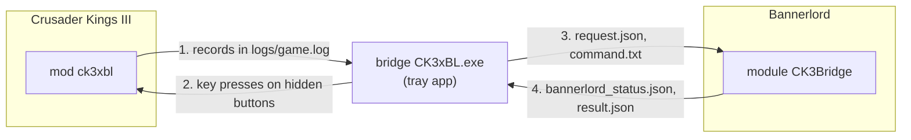
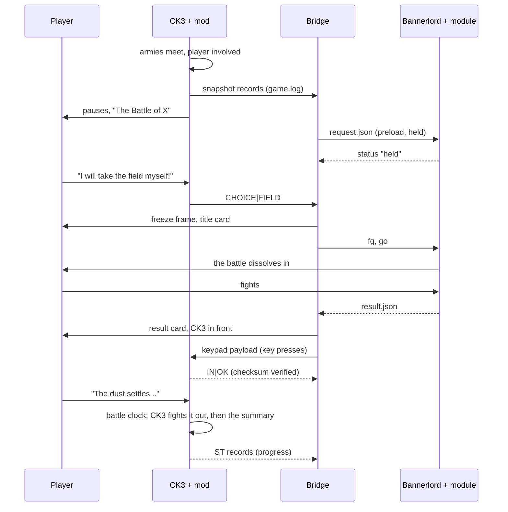

# How Crowns & Blades works

Crusader Kings III and Bannerlord were never meant to talk to each other. CK3's script cannot open files or sockets, and the
two games run as separate programs. This page explains how the project gets a battle out of one game, into the other, and the
result back again, without touching either game's files and without switching off CK3's achievements.

The exact formats are in [PROTOCOL.md](PROTOCOL.md). This page is the overview.

## The three components

| Component | Written in | Lives in | Job |
|---|---|---|---|
| **CK3 mod** `ck3xbl` ("Crowns & Blades Battles") | CK3 script, generated by `tools/gen/gen_ck3_mod.mjs` | `ck3_mod/ck3xbl` | Reports player battles to the log, asks the player, receives the result, applies it and steers CK3's combat |
| **Bridge** `CK3xBL.exe` | C# (.NET 10, WinForms tray app) | `bridge/` | Reads CK3's log, plans the Bannerlord battle, runs Bannerlord, stages the switch between the games, sends the result back |
| **Bannerlord module** `CK3Bridge` | C# (.NET Framework 4.7.2, Bannerlord's API) | `bannerlord_module/CK3Bridge` | Builds and runs the battle, reports its state and result |

The bridge and the module share one set of data classes, `shared/Protocol.cs`, compiled into both.



The files of channels 3 and 4 live in `%LOCALAPPDATA%\ck3xbl\`, next to the bridge's logs.

## One battle, end to end



## Out of CK3: the log channel

CK3's script language can write to the game's log files with `info_log`, and that works in normal (release) mode, without
debug mode. So the mod reports everything as **records**: one line `CK3XBL|<type>|...`, usually followed by a dump of the
values the script saved just before (`info_log_scopes`).

When a battle starts (`on_combat_start`) and the player is involved, the mod writes a **snapshot** in one go: the place
(terrain, winter, holding, coast, river, siege, development), every side, every army with its men-at-arms regiments and
levies, every commander and knight with their skills, traits, culture, accolade and artifacts. Script cannot print numbers into
a log line, so numbers travel in the dumps, and names such as a culture key are printed by generated `if` chains over every key
the game has.

The bridge follows `logs/game.log` like `tail -f`, pieces the records together, and builds a model of the battle. It also reads
`logs/dedicated_server.log`, where CK3 notes every pause and unpause.

The mod pauses CK3 itself: its battle notice belongs to a message filter with `auto_pause = yes`, so CK3 stops in the same tick
the battle starts. The bridge never presses Space.

## Into CK3: the keypad channel

Getting the result *into* CK3 is the hard part. The console could run a script file, but using it disables achievements. So the
mod brings its own input device:

- The event "The Armies Clash" contains invisible 1x1 buttons. Each is bound to one of CK3's **modder hotkeys**:
  Ctrl+Shift+Alt with `0`-`9`, `F1`, `F2`, `F3` or `F5`. CK3 runs a button's scripted GUI when its hotkey is pressed, even while
  the game is paused.
- The buttons form a tiny calculator: digits build a number, **F1** stores it in the next of 200 registers (character variables
  on the player), **F5** jumps to a register, **F3** clears everything, and **F2** commits.
- On commit, the mod checks a position-weighted checksum over all registers. If it matches, it logs `IN|OK`, and the bridge
  knows CK3 has the result. Otherwise it logs `IN|BAD` and the bridge sends everything once more.
- The registers have fixed meanings: the outcome, the losses of up to 8 armies (levies and each men-at-arms type), the fates of
  up to 20 characters, rewards for up to 8 heroes, the kill targets and pace of the battle clock.

The bridge presses the keys with `SendInput`, by scan code, so the keyboard layout does not matter. Before every burst and every
key it checks that CK3 is the foreground window and that the player is not holding a key; it waits for a quiet moment and holds
back physical key presses and clicks for at most a few seconds while it types. In the play tests a result was 100 to 200
keys and took 3 to 7 seconds; big battles with many armies and characters take longer.

In **Dev mode** the bridge instead writes the same registers into a script file in CK3's `run` folder and types
`run ck3xbl_apply.txt` into the console.

## The battle clock

Applying a result instantly would make CK3 skip its own battle resolution, and with it the war score. Instead, the result is
fought out by CK3:

1. When the player clicks "The dust settles...", the mod applies the character fates and rewards, stores each army's final
   state from Bannerlord, and starts **steering**.
2. Every day, a pulse compares the dead so far with the targets from Bannerlord and adjusts temporary combat modifiers on both
   sides, a damped controller that brings CK3's own combat to the Bannerlord numbers by the chosen day (12 by default).
3. When the targets are reached, the Bannerlord winner is declared the winner (`set_winner`), so CK3 ends the battle the normal
   way: war score, battle summary and aftermath are native.
4. One day later, every army's men-at-arms and levies are set exactly to their Bannerlord survivors, and the summary event opens.

If the losing side is reinforced while this runs, the mod suspends the steering, writes a new snapshot of the live battle and
offers a **second clash**. The bridge plans it from the first clash (same field, the armies capped at what was left) and adds
both clashes' losses together.

## The Bannerlord module

The bridge starts Bannerlord directly, without the launcher:

```
Bannerlord.exe /singleplayer _MODULES_*Native*SandBoxCore*CustomBattle*CK3Bridge*_MODULES_
```

It sets the environment variable `CK3XBL_HOST` on that process. The module is **inactive unless it finds it** (or a fresh launch
note from a running bridge), so a player who ticks "CK3 Bridge" for their own campaign gets an untouched game.

When active, the module:

- skips the intro and menus and waits on a black, silent screen, hidden (cloaked) and with a low frame rate;
- writes a **heartbeat** to `bannerlord_status.json` about every second: `idle`, `loading`, `held`, `visible`, `fighting`,
  `result`, and so on;
- takes `request.json`, builds a custom battle from it (scene, season, time of day, troops per group, heroes with faces,
  equipment, skills and banners, captains, buffs), loads it and **holds** it paused behind a black card until the bridge sends
  `go`;
- counts every soldier by the CK3 group it came from (levies of an army, one men-at-arms regiment, a knight's retinue), and
  every hero's kills and who struck them down;
- shows the result line and countdown, then writes `result.json`, fades to black and goes back to its idle screen.

Commands such as `go`, `cancel`, `abort`, `fg`, `bg` (show or hide the window) and `quit` arrive one at a time in
`command.txt`. The module never sees CK3, and the bridge never touches Bannerlord's internals: the files are the whole contract.

## Mapping CK3 to Bannerlord

The bridge's mapper turns a CK3 snapshot into a Bannerlord request, using tables in `bridge/data/`:

- **Troops:** every CK3 men-at-arms type and every culture's levies map to Bannerlord troops by role, culture, era and
  heritage. Large armies are scaled to a budget of soldiers (1,000 by default), with a minimum per side, and the result is scaled
  back up per group, so CK3's losses stay exact per army and men-at-arms type.
- **The battlefield:** CK3's terrain, climate region, holding and season pick a Bannerlord battle map and a time of day.
- **Heroes:** the player (or a stand-in commander), every army commander and every knight become named heroes with skills,
  equipment of their culture and rank, and their CK3 artifacts as matching items.
- **Faces:** for the player and the heir, the bridge reads the exact genes from the newest save's header (read-only) and
  rebuilds the face with Bannerlord's face keys; other characters get a stable look from their stored DNA or their ethnicity.
- **Banners:** coats of arms come from the save's coat-of-arms database or the game's predefined ones. The bridge renders them
  from your CK3 install's textures for the cards, and converts them into Bannerlord banner codes.
- **Results:** Bannerlord casualties become CK3 dead by configurable shares (more for the loser, plus pursuit), heroes who fell
  roll CK3's own fate odds (wounded, maimed, killed, captured), and heroes who did well earn prestige, glory and prowess.

## The switch between the games

The "seamless" part is window work in the bridge:

1. **Freeze frame:** the bridge captures CK3's last frame and shows it in its own overlay window, so the cut is invisible.
2. **Title card:** the frame darkens into a card drawn in CK3's style (CK3's own font, read from the install).
3. **Bannerlord comes forward:** it was loaded and held all along; the module uncloaks it, and the card dissolves into the live
   battle. Sound is ramped: CK3 down, Bannerlord up.
4. **The way back:** a result card, CK3 brought to the front (the overlay never takes focus), volumes restored, Bannerlord hidden
   and muted again.

The overlay is click-through and removes itself if the player switches to another program. The bridge never leaves a window
"always on top", never takes the foreground from a program the player chose, and remembers each game's own volume so it can be
restored even after a crash.

## How it is tested

- `dotnet run --project bridge/CK3xBL.SelfTest` runs the bridge's tests, including an **end-to-end contract test that needs no
  game**: a CK3 log generated from the mod's own statements is parsed, mapped, written as a request, read back with Bannerlord's
  own JSON library and settings, answered with a result, encoded as key presses, and replayed through the mod's generated
  keypad, commit and apply scripts, parsed straight from the mod's files.
- The Node tests (`tools/gen/test_ck3_mod.mjs`) run the mod's script, including the battle clock, in a small CK3-script
  interpreter (`tools/gen/lib/scriptsim.mjs`). The generator has a `--check` mode, the mod a lint, and the module a self-check.
- Everything that needs the real games was tested in live sessions; see the status in the [README](../README.md#status).

Details of every channel, record and register are in [PROTOCOL.md](PROTOCOL.md).
